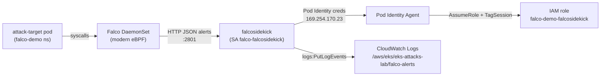

# Runtime Threat Detection with Falco → CloudWatch (EKS Pod Identity)

Deploys [Falco](https://falco.org/) on the lab EKS cluster and forwards every runtime alert through [falcosidekick](https://github.com/falcosecurity/falcosidekick) into **AWS CloudWatch Logs**, authenticating with **EKS Pod Identity** (no static keys, no IRSA). Then trigger real Falco rules from a target pod and watch the alerts land in CloudWatch.

All steps are manual (AWS CLI + Helm + kubectl). Terraform is only used for the base cluster in [`initial-lab-deploy-trfm/`](../initial-lab-deploy-trfm/).

## What is Falco?

A CNCF-graduated runtime security engine. It hooks syscalls on every node (modern eBPF probe) and matches them against rules — shells spawned in containers, sensitive file reads, unexpected outbound connections, privilege escalation, etc. **falcosidekick** is its companion: it receives Falco's JSON alerts over HTTP and fans them out to 60+ outputs (here: CloudWatch Logs).



---

## Gotchas This Demo Solves

> [!WARNING]
> **The falco chart's default falcosidekick image (2.32.0) cannot use IRSA or Pod Identity.**
> 2.32.0 builds its AWS config by hand (`&aws.Config{Region: region}`) with **no credential provider**, so the STS call goes out unsigned:
> ```
> [ERROR] : AWS - Error while getting AWS Token: operation error STS: GetCallerIdentity, https response error StatusCode: 403, ... api error MissingAuthenticationToken: Request is missing Authentication Token
> [INFO]  : Enabled Outputs: []
> ```
> Fixed upstream in **2.33.0** (switched to `awsconfig.LoadDefaultConfig()` → the standard SDK credential chain, which supports Pod Identity). [`values.yaml`](values.yaml) pins **2.35.0**.

| Problem | Symptom | Fix |
|---------|---------|-----|
| Default image 2.32.0 has no credential chain | `MissingAuthenticationToken`, `Enabled Outputs: []` | `falcosidekick.image.tag: 2.35.0` in [`values.yaml`](values.yaml) |
| falcosidekick never creates log groups | `ResourceNotFoundException` on `PutLogEvents` | Create the log group yourself (step 5) |
| Policy only lists the bare log-group ARN | `AccessDeniedException ... logs:PutLogEvents on ...:log-stream:...` | Policy must include `<log-group-arn>:*` (step 4) |
| Policy targets a different log group name | Same `AccessDeniedException` | Use the same `$LOG_GROUP` everywhere (IAM, log group, `values.yaml`) |
| Pods started before the association existed | No `AWS_CONTAINER_*` env vars, STS errors | Create the association **before** `helm install` (step 6), or restart the pod |
| 2 sidekick replicas split traffic | `kubectl logs deployment/...` shows "nothing happening" | `replicaCount: 1` in [`values.yaml`](values.yaml) |
| IRSA annotation + Pod Identity on the same SA | IRSA wins (web identity precedes the container provider) | Keep `rolearn: ""` in [`values.yaml`](values.yaml) |

---

## What This Demo Deploys

### AWS Resources (AWS CLI)

| Resource | Name | Purpose |
|----------|------|---------|
| EKS add-on | `eks-pod-identity-agent` | Serves Pod Identity credentials on `169.254.170.23` (skip if already installed, e.g. by [`mkat-demo/`](../mkat-demo/)) |
| IAM Role | `falco-demo-falcosidekick` | Trusts `pods.eks.amazonaws.com` (`sts:AssumeRole` + `sts:TagSession`) |
| IAM inline policy | `falcosidekick-cloudwatch-logs` | `logs:CreateLogStream`, `logs:DescribeLogStreams`, `logs:PutLogEvents` on the alerts log group only |
| CloudWatch Log Group | `/aws/eks/eks-attacks-lab/falco-alerts` | Alert destination, 30-day retention |
| Pod Identity association | `falco` / `falco-falcosidekick` → role | Binds the falcosidekick ServiceAccount to the role |

### Kubernetes Resources (Helm + kubectl)

| Component | Namespace | Purpose |
|-----------|-----------|---------|
| Helm release `falco` (chart `falcosecurity/falco` 9.2.0) | `falco` | Falco DaemonSet (modern eBPF) + falcosidekick 2.35.0, configured by [`values.yaml`](values.yaml) |
| `falco-falcosidekick` ServiceAccount | `falco` | Created by the chart; name is fixed (`<release>-falcosidekick`) and matches the association |
| `attack-target` Deployment (`alpine:3.20`) | `falco-demo` | Harmless pod to trigger Falco rules against |

The chart wires Falco → falcosidekick automatically when `falcosidekick.enabled: true` (`json_output: true`, `http_output.url: http://falco-falcosidekick:2801`).

---

## Prerequisites

- EKS cluster deployed via [`initial-lab-deploy-trfm/`](../initial-lab-deploy-trfm/)
- [AWS CLI v2](https://docs.aws.amazon.com/cli/latest/userguide/getting-started-install.html) configured with permissions for IAM, EKS, and CloudWatch Logs
- [Helm](https://helm.sh/docs/intro/install/) >= 3.8
- [kubectl](https://kubernetes.io/docs/tasks/tools/)
- `curl` (for the falcosidekick test endpoint)

---

## Deploy the Lab

### 0. Set Variables (used by every step below — keep the same shell)
```bash
export CLUSTER=eks-attacks-lab
export REGION=us-east-1
export ACCOUNT_ID=$(aws sts get-caller-identity --query Account --output text)
export NAMESPACE=falco
export SA=falco-falcosidekick                       # fixed by the chart: "<release>-falcosidekick"
export ROLE=falco-demo-falcosidekick
export LOG_GROUP=/aws/eks/eks-attacks-lab/falco-alerts   # must match values.yaml
export LOG_GROUP_ARN=arn:aws:logs:${REGION}:${ACCOUNT_ID}:log-group:${LOG_GROUP}
```

### 1. Update kubeconfig
```bash
aws eks update-kubeconfig --name $CLUSTER --region $REGION
kubectl get nodes
```

### 2. Clean Up a Previous Install (skip on a fresh cluster)
Removes any earlier Falco release, IRSA leftovers, old association, log group, and role so you start clean.
```bash
# Helm release + namespace
helm uninstall falco -n $NAMESPACE 2>/dev/null
kubectl delete namespace $NAMESPACE --ignore-not-found

# Old Pod Identity association(s) for falco/falco-falcosidekick
for id in $(aws eks list-pod-identity-associations --cluster-name $CLUSTER --region $REGION \
    --namespace $NAMESPACE --service-account $SA \
    --query 'associations[].associationId' --output text); do
  aws eks delete-pod-identity-association --cluster-name $CLUSTER --region $REGION --association-id "$id"
done

# Old log group (deletes any alerts in it)
aws logs delete-log-group --log-group-name $LOG_GROUP --region $REGION 2>/dev/null

# Old roles — the earlier manual IRSA role and/or this demo's role.
# Inline + attached policies must be removed before a role can be deleted.
for R in EKS-Falcosidekick-Role $ROLE; do
  for p in $(aws iam list-role-policies --role-name $R --query 'PolicyNames[]' --output text 2>/dev/null); do
    aws iam delete-role-policy --role-name $R --policy-name "$p"; done
  for a in $(aws iam list-attached-role-policies --role-name $R --query 'AttachedPolicies[].PolicyArn' --output text 2>/dev/null); do
    aws iam detach-role-policy --role-name $R --policy-arn "$a"; done
  aws iam delete-role --role-name $R 2>/dev/null
done
```

### 3. Install the EKS Pod Identity Agent
The add-on is shared with [`mkat-demo/`](../mkat-demo/) — check first, install only if missing:
```bash
STATUS=$(aws eks describe-addon --cluster-name $CLUSTER --addon-name eks-pod-identity-agent \
  --region $REGION --query addon.status --output text 2>/dev/null)
echo "pod-identity-agent: ${STATUS:-NOT INSTALLED}"

if [ -z "$STATUS" ]; then
  aws eks create-addon --cluster-name $CLUSTER --addon-name eks-pod-identity-agent --region $REGION
  aws eks wait addon-active --cluster-name $CLUSTER --addon-name eks-pod-identity-agent --region $REGION
fi

# One agent pod per node (DESIRED = READY)
kubectl get daemonset eks-pod-identity-agent -n kube-system
```

### 4. Create the IAM Role + Least-Privilege Policy
Trust policy — the EKS Pod Identity service principal (`sts:TagSession` is mandatory):
```bash
aws iam create-role --role-name $ROLE \
  --tags Key=Project,Value=eks-attacks-lab Key=Demo,Value=falco \
  --assume-role-policy-document '{
    "Version": "2012-10-17",
    "Statement": [{
      "Effect": "Allow",
      "Principal": { "Service": "pods.eks.amazonaws.com" },
      "Action": ["sts:AssumeRole", "sts:TagSession"]
    }]
  }'
```

Permissions — only this log group. `PutLogEvents` is authorized against the **log stream** ARN (`...:log-group:<name>:log-stream:<stream>`), so the `:*` resource is required; the bare log-group ARN alone gives `AccessDeniedException`:
```bash
aws iam put-role-policy --role-name $ROLE --policy-name falcosidekick-cloudwatch-logs \
  --policy-document '{
    "Version": "2012-10-17",
    "Statement": [{
      "Sid": "WriteFalcoAlerts",
      "Effect": "Allow",
      "Action": ["logs:CreateLogStream", "logs:DescribeLogStreams", "logs:PutLogEvents"],
      "Resource": ["'"$LOG_GROUP_ARN"'", "'"$LOG_GROUP_ARN"':*"]
    }]
  }'

# Verify the resolved ARNs
aws iam get-role-policy --role-name $ROLE --policy-name falcosidekick-cloudwatch-logs \
  --query 'PolicyDocument.Statement[0].Resource'
```

### 5. Create the CloudWatch Log Group
falcosidekick **never** creates log groups (it only creates a stream when `logstream` is empty):
```bash
aws logs create-log-group --log-group-name $LOG_GROUP --region $REGION \
  --tags Project=eks-attacks-lab,Demo=falco
aws logs put-retention-policy --log-group-name $LOG_GROUP --retention-in-days 30 --region $REGION
```

### 6. Create the Pod Identity Association
Must exist **before** the falcosidekick pod starts — credentials are only injected into pods created after it:
```bash
aws eks create-pod-identity-association --cluster-name $CLUSTER --region $REGION \
  --namespace $NAMESPACE --service-account $SA \
  --role-arn arn:aws:iam::${ACCOUNT_ID}:role/${ROLE}

aws eks list-pod-identity-associations --cluster-name $CLUSTER --region $REGION --namespace $NAMESPACE
```
> The namespace and ServiceAccount don't need to exist yet — the association is matched when the pod is created.

### 7. Install Falco + falcosidekick (Helm)
Run from this `falco-demo/` directory:
```bash
helm repo add falcosecurity https://falcosecurity.github.io/charts
helm repo update

helm upgrade --install falco falcosecurity/falco --version 9.2.0 \
  -n $NAMESPACE --create-namespace \
  -f values.yaml \
  --wait --timeout 10m
```
> The release name **must** be `falco` — the chart names the ServiceAccount `<release>-falcosidekick`, which is what the association in step 6 targets. If you changed `LOG_GROUP` or `REGION`, update [`values.yaml`](values.yaml) to match.

### 8. Verify
```bash
# Falco DaemonSet (1 per node) + 1 falcosidekick pod, all Running
kubectl get pods -n $NAMESPACE

# Image is 2.35.0 (NOT the chart default 2.32.0)
kubectl get deploy falco-falcosidekick -n $NAMESPACE -o jsonpath='{.spec.template.spec.containers[0].image}{"\n"}'

# Pod Identity creds injected (expect these 2 vars)
kubectl exec -n $NAMESPACE deploy/falco-falcosidekick -- env | grep AWS_CONTAINER
#   AWS_CONTAINER_CREDENTIALS_FULL_URI=http://169.254.170.23/v1/credentials
#   AWS_CONTAINER_AUTHORIZATION_TOKEN_FILE=/var/run/secrets/pods.eks.amazonaws.com/serviceaccount/eks-pod-identity-token

# Startup: NO "Error while getting AWS Token", CloudWatch output enabled
kubectl logs -n $NAMESPACE deploy/falco-falcosidekick
#   [INFO]  : Falcosidekick version: 2.35.0
#   [INFO]  : Enabled Outputs: [AWSCloudWatchLogs]
#   [INFO]  : Falcosidekick is up and listening on :2801
```
If `AWS_CONTAINER_*` is missing, the pod started before the association — restart it:
```bash
kubectl rollout restart deploy/falco-falcosidekick -n $NAMESPACE
```

### 9. Deploy the Attack Target
```bash
kubectl create namespace falco-demo
kubectl create deployment attack-target -n falco-demo --image=alpine:3.20 -- sleep infinity
kubectl rollout status deploy/attack-target -n falco-demo
```

---

## Demo Walkthrough

Open a second terminal and follow the alerts live:
```bash
aws logs tail /aws/eks/eks-attacks-lab/falco-alerts --follow --region us-east-1
```

### 1. Pipeline Smoke Test (falcosidekick → CloudWatch, bypasses Falco)
```bash
kubectl port-forward -n falco svc/falco-falcosidekick 2801:2801 &
sleep 2
curl -sX POST http://localhost:2801/test
kubectl logs -n falco deploy/falco-falcosidekick --tail=3
#   [INFO]  : AWS CloudWatchLogs - Send Log OK (...)
kill %1
```
The test event (`rule: "Test rule"`) bypasses `minimumpriority`, so it proves auth + IAM + log group without needing Falco.

### 2. Terminal Shell in Container (Notice)
```bash
kubectl exec -it -n falco-demo deploy/attack-target -- sh
# then type: exit
```
**Expected alert:** `Terminal shell in container` — `A shell was spawned in a container with an attached terminal`

### 3. Read Sensitive File (Warning)
```bash
kubectl exec -n falco-demo deploy/attack-target -- cat /etc/shadow
```
**Expected alert:** `Read sensitive file untrusted` — `Sensitive file opened for reading by non-trusted program (file=/etc/shadow ...)`

### 4. Confirm Falco Fired (node side)
```bash
kubectl logs -n falco -l app.kubernetes.io/name=falco -c falco --tail=20 | grep -E "Notice|Warning"
```

### 5. Query in CloudWatch Logs Insights
Console → CloudWatch → Logs Insights → select `/aws/eks/eks-attacks-lab/falco-alerts`:
```
fields @timestamp, priority, rule, output_fields.k8s.ns.name, output_fields.k8s.pod.name, output
| sort @timestamp desc
| limit 50
```
Only high-severity:
```
fields @timestamp, rule, output
| filter priority in ["Warning", "Error", "Critical", "Alert", "Emergency"]
| sort @timestamp desc
```

---

## Troubleshooting

| Log line in falcosidekick | Cause | Fix |
|---------------------------|-------|-----|
| `MissingAuthenticationToken` | Image < 2.33.0, or no creds injected | Check image tag (step 8); check `env \| grep AWS_CONTAINER`; restart the deployment |
| `Enabled Outputs: []` | Startup identity check failed (see the line above it) | Fix the preceding error, then restart |
| `AccessDeniedException ... logs:PutLogEvents` | Policy resource doesn't cover `<log-group-arn>:*`, or names don't match | Re-run step 4 with the same `$LOG_GROUP` as `values.yaml` |
| `ResourceNotFoundException` | Log group missing | Re-run step 5 |
| Nothing at all after triggering | Event never reached falcosidekick | Walkthrough step 4 — confirm Falco fired the rule |

---

## Clean Up

```bash
# Kubernetes
kubectl delete namespace falco-demo --ignore-not-found
helm uninstall falco -n $NAMESPACE
kubectl delete namespace $NAMESPACE --ignore-not-found

# Pod Identity association
for id in $(aws eks list-pod-identity-associations --cluster-name $CLUSTER --region $REGION \
    --namespace $NAMESPACE --service-account $SA \
    --query 'associations[].associationId' --output text); do
  aws eks delete-pod-identity-association --cluster-name $CLUSTER --region $REGION --association-id "$id"
done

# IAM role
aws iam delete-role-policy --role-name $ROLE --policy-name falcosidekick-cloudwatch-logs
aws iam delete-role --role-name $ROLE

# Log group (deletes all alerts)
aws logs delete-log-group --log-group-name $LOG_GROUP --region $REGION

# Pod Identity Agent — ONLY if nothing else (e.g. mkat-demo) uses it
# aws eks delete-addon --cluster-name $CLUSTER --addon-name eks-pod-identity-agent --region $REGION
```

---

## References

- [Falco Documentation](https://falco.org/docs/)
- [falcosidekick — AWS CloudWatch Logs output](https://github.com/falcosecurity/falcosidekick/blob/master/docs/outputs/aws_cloudwatch_logs.md)
- [Falco Helm chart](https://github.com/falcosecurity/charts/tree/master/charts/falco)
- [falcosidekick commit 4f0cd31 — use recommended AWS credential provider chain (first in 2.33.0)](https://github.com/falcosecurity/falcosidekick/commit/4f0cd31)
- [EKS Pod Identity Documentation](https://docs.aws.amazon.com/eks/latest/userguide/pod-identities.html)

## File Structure

```
falco-demo/
├── README.md     # This file — overview, gotchas, manual deploy steps, walkthrough, troubleshooting
└── values.yaml   # Helm values: falcosidekick 2.35.0, Pod Identity, CloudWatch Logs output
```
