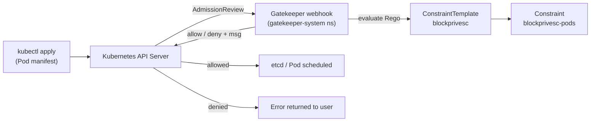

# Admission Control with OPA Gatekeeper (Blocking Privileged Pods)

Deploys [OPA Gatekeeper](https://open-policy-agent.github.io/gatekeeper/) on the lab EKS cluster and enforces an admission policy that **denies Pods running as `privileged: true` or adding any Linux capabilities** — two of the most common pod-to-node escape primitives. Then tests the policy both live against the API server and offline with `gator` (the way you would in a CI pipeline).

The base cluster is deployed with Terraform from [`initial-lab-deploy-trfm/`](../initial-lab-deploy-trfm/). Gatekeeper is installed with Helm and the policies are applied with kubectl.

Further reading: [OPA and Gatekeeper - Policy Enforcement for Kubernetes (k8s.guide)](https://k8s.guide/)

## What is OPA Gatekeeper?

[Open Policy Agent (OPA)](https://www.openpolicyagent.org/) is a general-purpose policy engine that evaluates policies written in **Rego**. **Gatekeeper** wraps OPA as a Kubernetes **validating admission webhook**: every create/update request sent to the API server is intercepted and checked against your policies before it is persisted. If a policy is violated, the request is denied with a descriptive message.



> [!NOTE]
> This demo focuses on security, but Gatekeeper can enforce anything expressible in Rego — required labels/tags, allowed image registries, resource limits, naming conventions, etc. The two rules here are just a starting point; the same approach extends to all the common pod escape vectors (`hostPID`, `hostNetwork`, `hostPath` mounts, `allowPrivilegeEscalation`, running as root, …).

---

## Key Concepts

| Object | Purpose |
|---|---|
| **ConstraintTemplate** | Defines the Rego logic and the schema of a new constraint kind. Applying it makes Gatekeeper generate a new CRD (here `BlockPrivesc`, taken from `spec.crd.spec.names.kind`). |
| **Constraint** | An instance of that CRD. Selects *which* objects the policy applies to (kinds, namespaces) and optionally passes `spec.parameters` into the template. |

### The policy in this demo

The `BlockPrivesc` template contains two `violation` rules:

1. **Block privileged containers** — any container with `securityContext.privileged: true` is rejected.
2. **Block added capabilities** — any container whose `securityContext.capabilities.add` list is non-empty is rejected (the message lists the offending capabilities).

The `blockprivesc-pods` constraint applies the template to **Pods** cluster-wide, excluding `kube-system` and `gatekeeper-system`.

> [!IMPORTANT]
> Always exclude `kube-system` and `gatekeeper-system` from your constraints. System components legitimately need elevated privileges, and as policies get more complex you can lock yourself out of the cluster (or break Gatekeeper itself) if they are not excluded.

---

## Deployment Steps

1. **Install Gatekeeper** — via the official Helm chart (`gatekeeper/gatekeeper`) into the `gatekeeper-system` namespace, then confirm the deployments in that namespace are ready.
2. **Create the ConstraintTemplate** — apply [`constraint-template.yaml`](constraint-template.yaml). This registers the Rego policy and creates the `BlockPrivesc` CRD.
3. **Create the Constraint** — apply [`constraint.yaml`](constraint.yaml) to start enforcing the policy on Pods.
4. **Test the constraint** — apply [`privpod.yaml`](privpod.yaml), a Pod with `privileged: true` and `NET_ADMIN` / `SYS_TIME` capabilities. The API server denies it with Gatekeeper's verbose violation messages for both rules.

---

## Shift-Left: Testing Policies with `gator`

Policies should be tested *before* they reach a cluster — especially in CI pipelines. Gatekeeper's `gator` CLI (installable with `go install` from the Gatekeeper repo) evaluates templates and constraints against sample manifests offline, with no cluster required.

`gator test` expects the manifests split into templates, constraints and test inputs, which is why this folder also contains:

- [`tempaltes/`](tempaltes/) — the ConstraintTemplate
- [`constraints/`](constraints/) — the Constraint
- [`test-inputs/`](test-inputs/) — manifests to evaluate (the privileged Pod)

Pointing `gator test` at these three locations reports the same violations the live webhook returned, and exits non-zero — so it can fail a pipeline before a bad manifest is ever deployed.

---

## References

- [OPA Gatekeeper Documentation](https://open-policy-agent.github.io/gatekeeper/website/docs/)
- [Gatekeeper Helm chart](https://open-policy-agent.github.io/gatekeeper/website/docs/install#deploying-via-helm)
- [gator CLI](https://open-policy-agent.github.io/gatekeeper/website/docs/gator)
- [Gatekeeper Policy Library](https://open-policy-agent.github.io/gatekeeper-library/website/)
- [Rego Policy Language](https://www.openpolicyagent.org/docs/latest/policy-language/)

## File Structure

```
opa-gatekeeper-demo/
├── README.md                              # This file — overview, concepts, deploy steps, gator testing
├── constraint-template.yaml               # ConstraintTemplate: Rego rules blocking privileged + added capabilities
├── constraint.yaml                        # BlockPrivesc constraint applied to Pods (excludes system namespaces)
├── privpod.yaml                           # Test Pod: privileged + NET_ADMIN/SYS_TIME (should be denied)
├── tempaltes/constraint-template.yaml     # gator layout: template
├── constraints/constraint.yaml            # gator layout: constraint
└── test-inputs/privpod.yaml               # gator layout: test input
```
